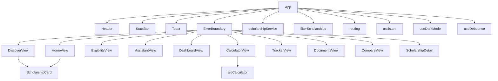

# GRANTLY Architecture

## Overview

GRANTLY is a React 18 + Vite 5 + TypeScript strict single-page app with no
backend. Scholarship data is a static typed list in `src/data/scholarships.ts`.
All user state is kept in the browser with localStorage.

## Component tree



```
App.tsx
  Header.tsx            topbar, logo, mobile Menu button, main navigation
                        (Home, Discover, Eligibility Check, Assistant,
                        Dashboard, My Applications, Documents, Compare)
  StatsBar.tsx          saved count, in-progress count, nearest deadline,
                        total scholarships listed
  Toast.tsx             short confirmation message, auto-dismisses
  ErrorBoundary.tsx     catches a failed view render, offers Try again
  CompareBar            shown in App when 1 to 3 scholarships are selected
                        for comparison; links to the Compare view
  HomeView.tsx          hero, real counts, 3-step How it works,
                        3 soonest-closing scholarships
  AssistantView.tsx     rule-based assistant, suggested questions,
                        answers from the 14 scholarships only
  DashboardView.tsx     saved count, applications by status, documents
                        progress, nearest deadline, top matches,
                        CSV and .ics export buttons
  CalculatorView.tsx    aid calculator: tick scholarships, enter an
                        annual cost, see total aid and the gap or
                        surplus, labelled as an estimate
  DiscoverView.tsx      filters, results count, scholarship grid
    ScholarshipCard.tsx View details, Save, Track, Compare, urgent
                        deadline style when 30 days or fewer are left
  EligibilityView.tsx   profile form, scored results with reasons
  TrackerView.tsx       applications, List / Board toggle, status select,
                        progress bar, CSV and .ics export buttons
  DocumentsView.tsx     12-item checklist, file records kept in the
                        browser only (name, size and date, no contents)
  CompareView.tsx       side by side table for up to 3 scholarships
  ScholarshipDetail.tsx modal: benefits, documents, how to apply
  footer                disclaimer and copyright
```

## Routing

Views are deep-linkable through the URL hash, with no router
dependency. `src/lib/routing.ts` holds the typed helpers:

- `parseViewFromHash(hash)` returns the view named in the hash, or
  `home` for a missing or unknown hash.
- `viewToHash(view)` returns `#home`, `#discover`, `#eligibility`,
  `#assistant`, `#dashboard`, `#calculator`, `#tracker`, `#documents` or `#compare`.

App reads the hash on load, listens for `hashchange` so the back and
forward buttons change the view, and writes the hash whenever the
view changes from a nav click, Track or View comparison. Both helpers
are covered by unit tests in `src/lib/routing.test.ts`.

## Services

`src/services/scholarshipService.ts` is the only data-access layer:
`getAllScholarships`, `getScholarshipById`, `getScholarshipsByState`
and `getUpcomingDeadlines`. App uses it for the nearest-deadline and
compare-list lookups. Filtering stays in `filterScholarships` and
eligibility scoring stays in `scoreEligibility`, so the service never
rewrites those rules. It is covered by unit tests in
`src/services/scholarshipService.test.ts`.

`src/constants.ts` holds the six localStorage keys, used by App
through `STORAGE_KEYS`, so a key is spelled once in the whole app.

## Data flow

- `SCHOLARSHIPS` (14 items) and `DOCUMENT_CHECKLIST` (12 items) live in
  `src/data/scholarships.ts`. Amounts, deadlines, providers and eligibility
  rules are not changed by any view.
- Discover filtering and sorting is a pure function,
  `filterScholarships(list, filters)` in `src/lib/filterScholarships.ts`.
  It is called from App with `useMemo` and is covered by unit tests.
- Eligibility scoring is a pure function, `scoreEligibility(profile, s)`
  in `src/lib/eligibility.ts`.
- Compare selection is a pure function, `toggleCompare(selected, id)` in
  `src/lib/compare.ts`, capped at 3 ids.
- Search input is sanitised in `src/lib/sanitize.ts` (trim, 100 chars,
  strips `< > " ' \``). No `dangerouslySetInnerHTML` anywhere.
- Search filtering is debounced: App passes the search text through
  `useDebounce` (`src/hooks/useDebounce.ts`, 300 ms), so the input
  stays responsive while filtering waits for typing to pause. The
  debounce timing is covered by unit tests of the `debounce` factory
  in the same file.
- Aid totals come from `sumSelectedAid` in `src/lib/aidCalculator.ts`,
  which adds only the listed amounts of the ticked scholarships.
  Export files come from `src/lib/exportData.ts`: `applicationsToCsv`
  escapes commas and quotes, and `deadlinesToIcs` writes one VEVENT
  per application on its deadline date. Downloads use a client-side
  Blob, so nothing is sent to a server. Both are covered by unit tests.

## State and localStorage keys

| State | Key | Hook |
|---|---|---|
| Saved scholarship ids | `grantly-saved` | `useLocalStorage` |
| Applications | `grantly-applications` | `useLocalStorage` |
| Documents checklist | `grantly-docs` | `useLocalStorage` |
| Compare selection | `grantly-compare` | `useLocalStorage` |
| Uploaded file records | `grantly-uploads` | `useLocalStorage` |
| Theme choice | `grantly-theme` | `useDarkMode` |
| Filters, profile, selected detail | in-memory `useState` only | - |

`useLocalStorage` in `src/hooks/useLocalStorage.ts` wraps `useState` with
the `load` / `save` helpers in `src/lib/storage.ts`, so App no longer
repeats a load-initializer plus a save `useEffect` for each key.

## Lazy loading and performance

- `DiscoverView`, `EligibilityView`, `TrackerView`, `DocumentsView`,
  `ScholarshipDetail`, `CompareView`, `HomeView`, `AssistantView`,
  `DashboardView` and `CalculatorView` are loaded with `React.lazy` and
  rendered inside one `Suspense` boundary in App with a skeleton
  loading state (two skeleton cards), and the whole boundary is wrapped
  in `ErrorBoundary`, which shows a fallback with a Try again button if
  a view fails to render. `Header` and `StatsBar` stay eager, so the
  first paint keeps the topbar and progress summary.
- `vite.config.js` sets `build.rollupOptions.output.manualChunks` with a
  `vendor` chunk for `react` and `react-dom`, so the framework code is
  cached separately from app code.
- No external fonts, images or heavy dependencies. Only system fonts and
  one small inline SVG favicon (`public/favicon.svg`).

## Responsive breakpoints

Defined in `src/index.css`, mobile-first in effect, navy `#0f2a44` and
teal `#0e7a6b` throughout, rectangular buttons (border-radius 4px):

- 1024px: stats 4 to 2 columns, filters and form 3 to 2 columns.
- 760px: stats stay 2 columns, filters, form and scholarship grid go to
  1 column, topbar stacks, modal padding shrinks. The nav is hidden
  behind a Menu button at this width and opens on tap; the button
  carries `aria-expanded` and `aria-controls`.
- 560px: stats go to 1 column, nav buttons go full width, buttons,
  selects and inputs get 44px minimum touch targets, action buttons go
  full width and stack, compare bar stacks.
- 400px: page and card padding shrink further, deadline badge goes full
  width so it never overflows a narrow screen.

Typography is fluid: the logo and `h1` use `clamp()`. Cards lift
slightly with a shadow on hover, buttons change background on hover and
focus, all with short 0.15s transitions. The compare table scrolls
horizontally inside `.table-wrap` on small screens instead of overflowing.

## Security headers

`vercel.json` sends `X-Content-Type-Options: nosniff`,
`X-Frame-Options: DENY`, `Referrer-Policy:
strict-origin-when-cross-origin`, a `Permissions-Policy` disabling
camera, microphone and geolocation, and a Content-Security-Policy that
allows self, inline styles and no external scripts.

## Tests

Vitest, run with `npm test`. Coverage: eligibility scoring, search
sanitisation, scholarship data integrity, date helpers, the filter and
sort function, the compare toggle and cap, hash routing, the
scholarship service, the rule-based assistant, uploads, theme
resolution, debounce timing, the aid calculator and the export
builders. 77 tests in 9 files.

## Assistant rule

`src/lib/assistant.ts` is a pure typed function, not a model call.
It matches the question against keywords (best match, closing
soonest, Girls, Merit, Need-based, income limit) and answers only
from the 14 scholarships and the eligibility results already
computed in App. Unknown questions get a short fallback listing
what it can answer. The view labels this plainly: rule-based,
answers only from the 14 scholarships in this app, not a live AI
model.

## Uploads note

DocumentsView records only a file name, size and date in
localStorage under `grantly-uploads`. The file input never reads
file contents and nothing is sent to a server. `src/lib/uploads.ts`
holds the add/remove helpers, covered by unit tests.

## Dark mode

`src/hooks/useDarkMode.ts` keeps the theme in state, persists it
under `grantly-theme`, and applies it as `data-theme` on the page
element. On first load it reads the saved choice, or the operating
system preference when nothing is saved. The pure
`resolveTheme(stored, prefersDark)` helper is covered by unit
tests. Dark overrides live in `src/index.css` under
`[data-theme="dark"]` and restyle the page background, cards, inputs,
buttons and badges in the same navy and teal palette with readable
contrast. Light mode is unchanged, and `prefers-reduced-motion`
still disables transitions in both themes.

## Aid calculator and export

The calculator view (`CalculatorView.tsx`) is presentation only. Its
numbers come from `src/lib/aidCalculator.ts`: `sumSelectedAid` adds
the listed amounts of the ticked scholarships, `aidGap` subtracts
total aid from the entered annual cost, and `formatRupees` formats
with Indian digit grouping. The view labels the result as an
estimate, not a guarantee. Export uses `src/lib/exportData.ts` and
`downloadTextFile`, which builds a Blob in the browser and triggers
a download. No server is involved in either feature.
